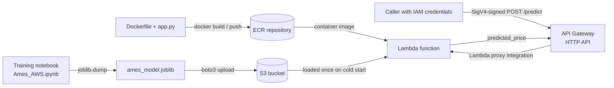

# Ames Housing Price Model — Serverless Deployment on AWS

This project takes a trained house-price model out of a notebook and turns it into a live, authenticated prediction endpoint on AWS. You send a request with a house's attributes and get back a predicted sale price.

The model is a tuned scikit-learn Gradient Boosting pipeline trained on the Ames, Iowa housing dataset (2,580 sales, 2006–2010). The original modeling and model-comparison work is still in this repo (see [Project history](#project-history)). The focus now is **deployment**: packaging, serving, securing and validating the model in the cloud.

**Stack:** AWS Lambda (container image) · Amazon ECR · Amazon S3 · API Gateway (HTTP API) · IAM / SigV4 · AWS Budgets · Docker · Python (boto3, scikit-learn, pandas, joblib)

---

## Architecture



| Piece | Role |
|---|---|
| **S3** | Stores the serialized model (`ames_model.joblib`). Only the model goes to the cloud. The raw CSV stays local. |
| **ECR** | Holds the Docker image that contains the Lambda handler and its pinned dependencies. |
| **Lambda** | Runs the container. It pulls the model from S3 into memory once per cold start, then serves predictions per request. |
| **API Gateway** | Exposes a single `POST /predict` route over HTTPS. |
| **IAM** | Authenticates callers (SigV4) and gives the Lambda execution role read access to the model in S3. |
| **Budgets** | A zero-spend alarm as a cost backstop. The whole stack runs inside the AWS free tier. |

---

## The model

| | |
|---|---|
| Algorithm | `GradientBoostingRegressor` (`n_estimators=190`, `max_depth=9`, `max_features="sqrt"`, `min_samples_leaf=4`) |
| Validation | 10-fold cross-validation, **R² = 0.906 (± 0.023)** |
| Input | One raw house record: the dataset's 79 columns, as named in `data/data_description.txt` |
| Output | Predicted sale price in USD |

Gradient Boosting was the strongest performer in the original model comparison (linear models, Lasso, random forest, gradient boosting). `Ames_AWS.ipynb` rebuilds that winning model cleanly and reproducibly.

The saved artifact is the **full pipeline**: preprocessing and model together. Anything that loads it can turn a raw record straight into a price, so training and serving can't drift apart. The preprocessing steps:

- **Numeric features:** mean imputation, then standard scaling. Six square-footage columns that just repeat aggregate totals are dropped.
- **Ordinal features** (quality ratings, exposure, finish and so on): ranked using the order in the data dictionary.
- **Nominal features** (neighborhood, roof style and so on): one-hot encoded.
- **Number-like categories** (`YearBuilt`, `YrSold`, `MSSubClass` and similar): cast to categories so that, for example, 2007 isn't treated as "one more" than 2006.
- **Unseen categories:** every encoder uses `handle_unknown` settings, so a category the model never saw is handled instead of crashing the encoder. In a notebook that crash is only an inconvenience. In Lambda it would be a 500 error.

The notebook also computes feature importances averaged across the 10 folds, so you can explain what drives a valuation.

---

## Deployment pipeline

All AWS work is done in Python with **boto3**. The AWS CLI and SageMaker were deliberately left out.

1. **Train and serialize:** fit the pipeline on the full dataset and save it as `ames_model.joblib`.
2. **Authenticate:** use a named AWS profile so no credentials ever appear in the notebook. `sts.get_caller_identity()` confirms who we are before anything else runs.
3. **Upload to S3:** create the bucket, upload the model, then download it back and check that the copy still predicts the same price.
4. **Containerize:** build the Lambda image from AWS's official `public.ecr.aws/lambda/python:3.11` base image. A container is used instead of a zip deployment because scikit-learn, pandas, NumPy and SciPy together exceed Lambda's 250 MB unzipped package limit.
5. **Push to ECR:** boto3 gets a temporary ECR token and pipes it into `docker login --password-stdin`, so the secret never lands in shell history. Then the image is tagged and pushed.
6. **Deploy and expose:** create a Lambda function from the image, with the `MODEL_BUCKET` and `MODEL_KEY` environment variables set. Front it with an API Gateway HTTP API route, `POST /predict`, using Lambda proxy integration.
7. **Lock it down:** require IAM (SigV4) authorization on the route.

### How the handler works (`app.py`)

- **Cold start:** the model is read from S3 straight into memory (`io.BytesIO`) once, outside the handler, and reused on every warm request. Writing it to disk isn't needed, and Lambda's filesystem is read-only outside `/tmp` anyway.
- **Request prep:** `prep_raw()` rebuilds each incoming record into the exact 79-column schema the pipeline was trained on:
  - missing columns become `NaN`, which the imputers then fill
  - unknown extra columns are dropped
  - column order is fixed
  - the same dtype casts as training are applied

  This guards against training–serving skew, where a model silently gets differently shaped data in production than it saw in training.
- **Two call styles, one contract:** through API Gateway (payload format 2.0), the request body arrives as a JSON *string* in `event["body"]`. A direct `lambda.invoke` passes the payload as-is. `_extract_features()` handles both. Every reply is wrapped in the proxy shape (`statusCode`, `headers`, stringified `body`), which API Gateway turns into a real HTTP response.
- **Bad input:** a missing `features` key or malformed JSON gets a `400` instead of an unhandled exception.

**Request:**

```json
{
  "features": {
    "GrLivArea": 1656,
    "OverallQual": 6,
    "Neighborhood": "NAmes",
    "YearBuilt": 1960,
    "GarageCars": 2
  }
}
```

You can send a partial record. Any of the 79 columns you leave out are imputed, though a fuller record gives a more reliable price.

**Response** (HTTP 200 from `POST /predict`):

```json
{ "predicted_price": 122822.8 }
```

That price is what the deployed pipeline returns for the five-field request above. With so many fields imputed, treat it as rough. A direct `lambda.invoke` returns the same payload wrapped in the proxy shape, so you read it from `json.loads(response["body"])`.

**Calling the endpoint** (the caller needs no scikit-learn, pandas or model file, only AWS credentials to sign with):

```python
import boto3, json, requests
from botocore.auth import SigV4Auth
from botocore.awsrequest import AWSRequest

creds = boto3.Session(profile_name="<your-profile>").get_credentials().get_frozen_credentials()
URL = "https://<api-id>.execute-api.us-east-1.amazonaws.com/predict"
body = json.dumps({"features": {"OverallQual": 7, "GrLivArea": 1710, "GarageCars": 2}})

req = AWSRequest(method="POST", url=URL, data=body, headers={"Content-Type": "application/json"})
SigV4Auth(creds, "execute-api", "us-east-1").add_auth(req)
print(requests.post(URL, data=body, headers=dict(req.headers)).json())
```

`profile_name` is a label that points at a section of the caller's local `~/.aws/credentials` file. The secret key stays on their machine. Only the signature it produces is sent.

---

## Security

- **IAM (SigV4) authentication** on the only route, `POST /predict`, scoped to least privilege. IAM was chosen over Cognito or JWT because the intended callers are internal and already inside the AWS trust boundary, so a separate identity provider would be overhead with no benefit.
- **Two separate principals:** the *caller* needs `execute-api:Invoke` on `POST /predict`. The *Lambda execution role* reads the model from S3.
- **No secrets in code:** the notebook uses a named profile, the ECR password is piped through stdin, and Lambda configuration comes from environment variables.

---

## Validation

The same prediction for a reference house, **$126,629.23** against an actual sale price of $126,000, was reproduced on four independent paths:

1. A local container, using the Lambda Runtime Interface Emulator
2. The S3 round trip (download the model and predict)
3. A direct Lambda invoke in the cloud
4. A SigV4-signed HTTPS `POST` through API Gateway

**Negative test:** an unsigned request to the endpoint is refused with **HTTP 403**.

---

## Reproducing it

**Prerequisites:** an AWS account, a named profile with permissions for S3, ECR, Lambda, API Gateway and IAM, Docker, and Python 3.11.

```bash
cd "AWS Project"
pip install -r requirements.txt boto3 jupyter matplotlib

# 1. Train, save, and upload the model (Stage 1 of the notebook).
#    Edit the profile name and BUCKET to your own values first.
jupyter notebook Ames_AWS.ipynb

# 2. Build the Lambda image. Force a Docker-format export:
#    Lambda rejects BuildKit's default OCI export.
docker buildx build --platform linux/amd64 --provenance=false --sbom=false --output type=docker -t ames-lambda:latest .

# 3. Authenticate to ECR (Stage 2 of the notebook), then tag and push
#    using the image URI the notebook prints.
docker tag ames-lambda:latest <account>.dkr.ecr.<region>.amazonaws.com/ames-lambda:latest
docker push <account>.dkr.ecr.<region>.amazonaws.com/ames-lambda:latest
```

Then create the Lambda function (`ames-predictor`) from that image, set `MODEL_BUCKET` (and optionally `MODEL_KEY`), and give its execution role read access to the model. **Stage 3** of the notebook covers the rest: the one-time console setup for the HTTP API and IAM policy, pointing the function at a new image, and the direct, signed and unsigned test calls.

> **Pin your versions.** `requirements.txt` pins scikit-learn 1.7.1, NumPy, SciPy, pandas and joblib to the versions the model was trained with. A pickled scikit-learn model and its library versions are a single unit: upgrade and retrain them together, never one without the other.

---

## Limitations

- **Market-specific:** the model learned Ames, Iowa, from 2006–2010. It will confidently price *any* input, including houses from other markets or years, without any warning.
- **Point estimates only:** no prediction intervals or confidence scores are returned.
- **S3 permissions are broader than needed:** the Lambda execution role uses the AWS-managed S3 read-only policy, which covers every bucket in the account. Scoping it to `s3:GetObject` on the one model object is the obvious next tightening step.
- **Internal-facing auth:** IAM/SigV4 suits AWS-internal callers. A public client would need a different front door, such as Cognito or an API key with throttling.

---

## Repository layout

```
AWS Project/                  ← the deployment project (current focus)
├── Ames_AWS.ipynb            training → S3 upload → ECR push → API Gateway + IAM tests
├── app.py                    Lambda handler
├── Dockerfile                Lambda container image
├── requirements.txt          pinned inference dependencies
├── ames_model.joblib         trained pipeline artifact
└── Ames_Housing_Price_Data.csv

data/                         raw dataset + data_description.txt (column definitions)
Pipeline Python Final/        original model comparison: linear, Lasso, random forest, gradient boosting
Initial Work/                 earliest exploratory Python and R notebooks
PowerPoint/                   presentation of the original modeling results
```

---

## Project history

This repo started as one of my first machine learning projects: an exploratory analysis and model comparison on the Ames dataset, looking for the most important price drivers and the model with the best cross-validated R². That work is kept in `Initial Work/`, `Pipeline Python Final/` and `PowerPoint/`.

The AWS phase reuses the best model from that work and adds what the original lacked: a reproducible training pipeline, a production-safe preprocessing contract, and a secured, tested, near-zero-cost cloud deployment.
